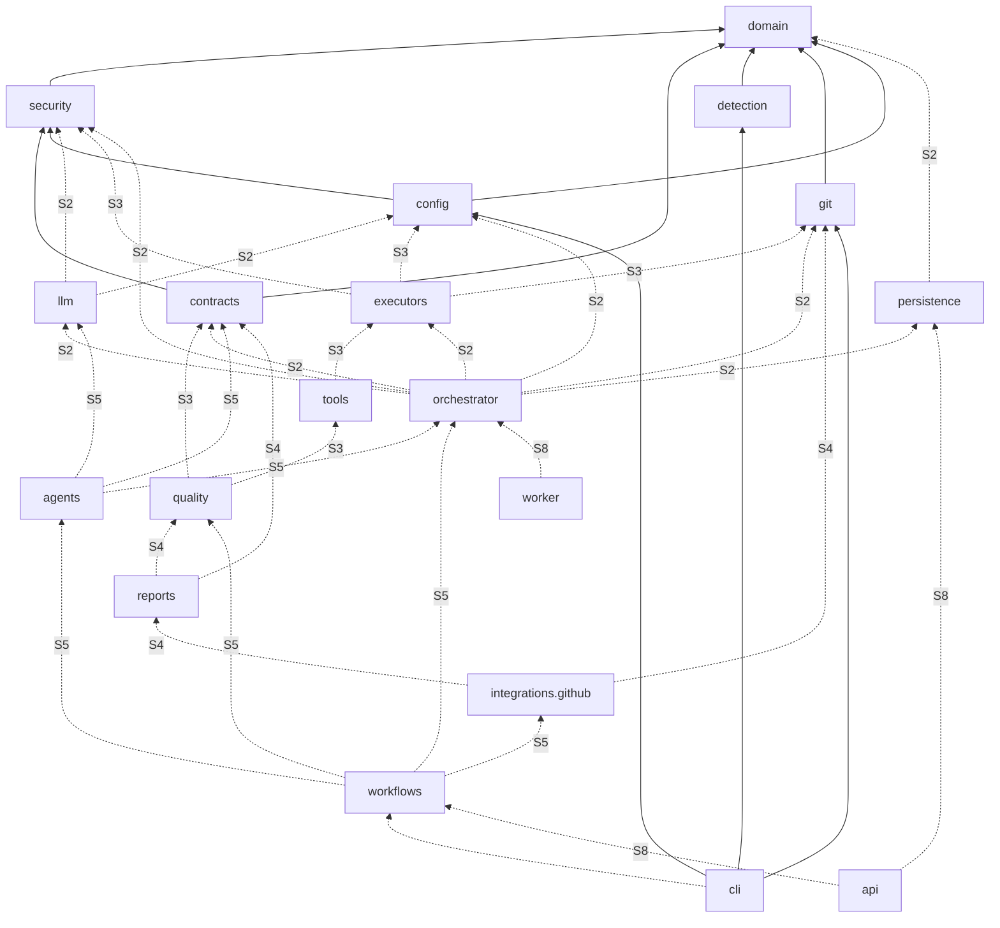

# Модули, зависимости и структура каталогов

## Структура репозитория

Отмечено: ✅ — реализовано в S1, ⏳ — спринт, в котором появится каталог/модуль. Пустые заглушки для будущих модулей **не создаются** — модуль появляется вместе с рабочим кодом и тестами.

```text
ai-coding-platform/
├── AI_Coding_Platform_v2_1_TZ.pdf     # ТЗ — основной источник требований
├── AI_Coding_Platform_v2_1_TZ.md      # конвертация ТЗ (с дефектами, см. docs/tz-notes.md)
├── README.md, LICENSE, SECURITY.md, CONTRIBUTING.md
├── pyproject.toml, uv.lock, Makefile   ✅ сборка, зависимости, линтеры, слои
├── .ai-coding.yml                      ✅ конфигурация платформы для самой себя (dogfooding)
├── .github/
│   ├── workflows/ci.yml                ✅ CI проекта
│   ├── workflows/repo-security.yml     ✅ gitleaks + pip-audit
│   ├── workflows/{quality,security,test-php,test-node,test-python,
│   │             test-go,test-rust,ai-review,release}.yml   ⏳ S4 reusable (workflow_call)
│   └── dependabot.yml                  ✅
├── docs/
│   ├── architecture/                   ✅ обзор, модули
│   ├── adr/                            ✅ ADR-0001…0015
│   ├── installation.md, development.md, configuration.md, cli.md   ✅
│   ├── backlog.md                      ✅ полный backlog по ТЗ
│   ├── tz-notes.md                     ✅ замечания к ТЗ
│   └── sprints/S1-report.md            ✅
├── src/ai_coding/
│   ├── domain/        ✅ перечисления ТЗ (Mode, RunState, Role, AgentName, …); ⏳ S2 сущности
│   ├── security/      ✅ redaction, детектор секретов; ⏳ S3 egress policy; ⏳ S8 authn/RBAC
│   ├── contracts/     ✅ контракт агента (AgentTask/AgentResult, валидация output_schema)
│   ├── detection/     ✅ определение стеков (FR-02)
│   ├── git/           ✅ порт GitRepository + LocalGitRepository (worktree, защита веток)
│   ├── config/        ✅ модели, JSON Schema, загрузчик, валидатор, генератор
│   ├── schemas/       ✅ ai-coding.schema.json; ⏳ S5 agents/*.output.schema.json
│   ├── templates/     ✅ шаблон .ai-coding.yml
│   ├── cli/           ✅ ai-coding --help / --version / init / config validate / config schema
│   ├── persistence/   ⏳ S2 SQLAlchemy-модели, репозитории, Alembic-миграции
│   ├── orchestrator/  ⏳ S2 planner, registry, router, workflow executor, context, state,
│   │                       checkpoint, policy, approval, aggregator, audit, retry
│   ├── llm/           ⏳ S2 порт/бюджеты; S5 openai, anthropic, ollama, vllm
│   ├── executors/     ⏳ S3 local, docker; S4 github_actions
│   ├── tools/         ⏳ S3 реестр; S7 semgrep, gitleaks, trivy, osv, phpstan, pint, eslint,
│   │                       tsc, ruff, mypy, go, golangci-lint, cargo, clippy, playwright, k6
│   ├── quality/       ⏳ S3 движок гейтов PASS/FAIL/SKIPPED, baseline
│   ├── reports/       ⏳ S4/S7 JSON, Markdown, SARIF, JUnit, PR-комментарии
│   ├── integrations/github/ ⏳ S4 GitHub API, App, checks, PR
│   ├── agents/        ⏳ S5–S7 12 агентов
│   ├── workflows/     ⏳ S5 create; S6 develop, modernize; S7 audit, maintain
│   ├── api/           ⏳ S8 FastAPI
│   └── worker/        ⏳ S8 серверный worker
├── tests/
│   ├── unit/          ✅
│   ├── integration/   ✅ (реальный git)
│   └── fixtures/      ✅
├── web/               ⏳ S8 React + TypeScript + Vite
└── deploy/            ⏳ S8 Dockerfile, docker-compose (API, worker, PostgreSQL, MinIO, Redis, proxy)
```

## Граф зависимостей модулей



Сплошные стрелки — существующие зависимости (проверяются import-linter), пунктир — плановые.

## Ответственность модулей

| Модуль | Ответственность | Ключевые порты | ТЗ |
| --- | --- | --- | --- |
| domain | Словарь предметной области, без I/O | — | §2–§6, §10 |
| security | Redaction, детект секретов, политика egress, authn/RBAC | `Redactor`, `PolicyDecision` | §12, FR-18 |
| config | `.ai-coding.yml`: модели, схема, валидация, генерация | `AICodingConfig` | §11 |
| contracts | Контракт агент↔оркестратор | `AgentTask`, `AgentResult` | §6 |
| detection | Определение стеков, ручное переопределение | `detect_stacks` | FR-02 |
| git | Рабочая копия, ветки, worktree, коммиты | `GitRepository` | §4, AC-03 |
| persistence | Сущности ТЗ §13, миграции, репозитории | `RunRepository`, `ArtifactStore`, `TaskQueue` | §13, NFR-03 |
| orchestrator | 12 компонентов ядра | `Planner`, `Router`, `StateManager`, … | §4, §5, FR-08/09 |
| llm | Провайдеры, бюджеты, маршрутизация, fallback | `LLMProvider` | §4, FR-15 |
| executors | Local / Docker / GitHub Actions | `Executor` | §4, §12 |
| tools | Адаптеры инструментов анализа | `ToolAdapter` | §4, §10 |
| quality | Гейты, baseline | `QualityGate` | §10, FR-11 |
| reports | JSON/MD/SARIF/JUnit, PR-комментарии без дублей | `Reporter` | FR-10 |
| integrations.github | PR, checks, reusable workflows | `RepositoryHost` | §9, FR-14, FR-17 |
| agents | 12 агентов ТЗ §6 | `Agent` | §6 |
| workflows | Сценарии пяти режимов | `ModeWorkflow` | FR-03…FR-07 |
| cli / api / worker | Точки входа | — | §4, §13, §14 |
