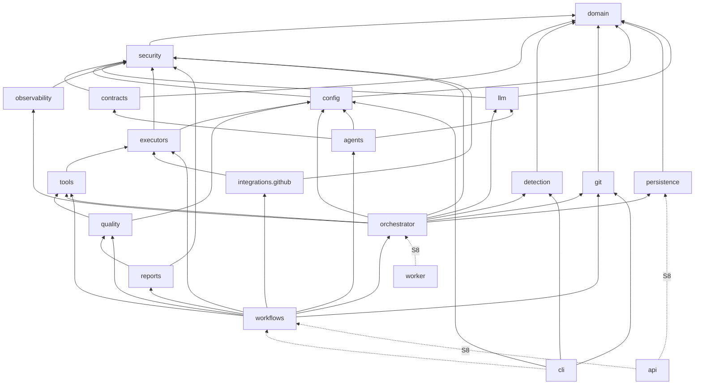

# Модули, зависимости и структура каталогов

## Структура репозитория

Отмечено: ✅ — реализовано в S1, ⏳ — спринт, в котором появится каталог/модуль. Пустые заглушки для будущих модулей **не создаются** — модуль появляется вместе с рабочим кодом и тестами.

```text
ai-coding-platform/
├── AI_Coding_Platform_v2_1_TZ.pdf     # ТЗ — основной источник требований
├── AI_Coding_Platform_v2_1_TZ.md      # Markdown-версия ТЗ, сгенерирована из PDF
├── README.md, LICENSE, SECURITY.md, CONTRIBUTING.md
├── pyproject.toml, uv.lock, Makefile   ✅ сборка, зависимости, линтеры, слои
├── .ai-coding.yml                      ✅ конфигурация платформы для самой себя (dogfooding)
├── .github/
│   ├── workflows/ci.yml                ✅ CI проекта
│   ├── workflows/repo-security.yml     ✅ gitleaks + pip-audit
│   ├── workflows/{quality,security,test-php,test-node,test-python,
│   │             test-go,test-rust,release}.yml   ✅ S4 reusable (workflow_call)
│   ├── workflows/pilots.yml            ✅ S4 пилоты AC-09 (examples/)
│   ├── workflows/ai-review.yml         ✅ S6 рекомендательный AI review (environment, без форков)
│   └── dependabot.yml                  ✅
├── docs/
│   ├── architecture/                   ✅ обзор, модули
│   ├── adr/                            ✅ ADR-0001…0026
│   ├── installation.md, development.md, configuration.md, cli.md   ✅
│   ├── audit.md (S3), github.md (S4), create.md (S5), develop.md (S6)   ✅
│   ├── backlog.md                      ✅ полный backlog по ТЗ
│   ├── tz-notes.md                     ✅ замечания к ТЗ
│   └── sprints/S1…S6-report.md         ✅
├── examples/pilot-python, pilot-node   ✅ S4 пилотные проекты (AC-09)
├── src/ai_coding/
│   ├── domain/        ✅ перечисления ТЗ, TaskStatus/Phase, ApprovalStatus, базовые ошибки
│   ├── security/      ✅ redaction, детектор секретов; ⏳ S8 authn
│   ├── contracts/     ✅ контракт агента (AgentTask/AgentResult, валидация output_schema)
│   ├── detection/     ✅ определение стеков (FR-02)
│   ├── git/           ✅ порт GitRepository + LocalGitRepository (worktree, защита веток)
│   ├── config/        ✅ модели, JSON Schema, загрузчик, валидатор, генератор
│   ├── schemas/       ✅ ai-coding.schema.json; ✅ S5 agents/*.output.schema.json
│   ├── templates/     ✅ шаблон .ai-coding.yml
│   ├── cli/           ✅ init, config validate|schema; ✅ S2 run discover|list|status|events|audit|
│   │                       resume|cancel|approve|reject
│   ├── persistence/   ✅ S2 SQLAlchemy-модели (15 сущностей ТЗ + run_events, effects), Alembic,
│   │                       append-only аудит, артефакты по SHA-256; ⏳ S8 PostgreSQL, MinIO
│   ├── orchestrator/  ✅ S2 planner, registry, router, engine (workflow executor), context, state,
│   │                       checkpoint, policy, approval, aggregator, audit, retry, effects, budget,
│   │                       встроенные discovery-обработчики
│   ├── llm/           ✅ S2 порт LLMProvider, GuardedLLM; ✅ S5 адаптеры openai/anthropic/ollama/vllm, router+fallback, кэш
│   ├── observability/ ✅ S2 structlog JSON + redaction + run_id/trace_id
│   ├── executors/     ✅ S3 port, local (allow-list, env allow-list, rlimits, kill tree), docker
│   │                       (hardened sandbox, --pull never); ⏳ S4 github_actions
│   ├── tools/         ✅ S3 реестр, runner, gitleaks, semgrep (офлайн-правила), ruff; ✅ S6 testrun (тесты в песочнице); ⏳ S7 trivy, osv,
│   │                       phpstan, pint, eslint, tsc, mypy, go, golangci-lint, cargo, clippy, playwright, k6
│   ├── quality/       ✅ S3 движок гейтов PASS/FAIL/SKIPPED, fail-closed, strict, baseline
│   ├── reports/       ✅ S3 JSON, Markdown; ✅ S4 SARIF 2.1.0, JUnit
│   ├── integrations/  ✅ S4 порт RepositoryHost; github/: клиент, App/token, PR, checks, rulesets, Actions executor
│   ├── agents/        ✅ S5 requirements, architect, planner, bootstrap; ✅ S6 developer, reviewer, database, planner.migration; ⏳ S7 остальные 5
│   ├── workflows/     ✅ S3 audit; ✅ S4 pull_request; ✅ S5 create; ✅ S6 develop, modernize, review, implement-цикл; ⏳ S7 maintain
│   ├── api/           ⏳ S8 FastAPI
│   └── worker/        ⏳ S8 серверный worker
├── tests/
│   ├── unit/          ✅
│   ├── integration/   ✅ (реальный git)
│   └── fixtures/      ✅
├── web/               ⏳ S8 React + TypeScript + Vite
└── deploy/            ⏳ S8 Dockerfile, docker-compose (API, worker, PostgreSQL, MinIO, Redis, proxy)
```

## Граф зависимостей модулей



Сплошные стрелки — существующие зависимости (проверяются import-linter), пунктир — плановые.

## Ответственность модулей

| Модуль | Ответственность | Ключевые порты | ТЗ |
| --- | --- | --- | --- |
| domain | Словарь предметной области, без I/O | — | §2–§6, §10 |
| security | Redaction, детект секретов, политика egress, authn/RBAC | `Redactor`, `PolicyDecision` | §12, FR-18 |
| config | `.ai-coding.yml`: модели, схема, валидация, генерация | `AICodingConfig` | §11 |
| contracts | Контракт агент↔оркестратор | `AgentTask`, `AgentResult` | §6 |
| detection | Определение стеков, ручное переопределение | `detect_stacks` | FR-02 |
| git | Рабочая копия, ветки, worktree, коммиты | `GitRepository` | §4, AC-03 |
| persistence | Сущности ТЗ §13, миграции, репозитории | `RunRepository`, `ArtifactStore`, `TaskQueue` | §13, NFR-03 |
| orchestrator | 12 компонентов ядра | `Planner`, `Router`, `StateManager`, … | §4, §5, FR-08/09 |
| llm | Провайдеры, бюджеты, маршрутизация, fallback | `LLMProvider` | §4, FR-15 |
| executors | Local / Docker / GitHub Actions | `Executor` | §4, §12 |
| tools | Адаптеры инструментов анализа | `ToolAdapter` | §4, §10 |
| quality | Гейты, baseline | `QualityGate` | §10, FR-11 |
| reports | JSON/MD/SARIF/JUnit, PR-комментарии без дублей | `Reporter` | FR-10 |
| integrations.github | PR, checks, reusable workflows | `RepositoryHost` | §9, FR-14, FR-17 |
| agents | 12 агентов ТЗ §6 | `Agent` | §6 |
| workflows | Сценарии пяти режимов | `ModeWorkflow` | FR-03…FR-07 |
| cli / api / worker | Точки входа | — | §4, §13, §14 |
