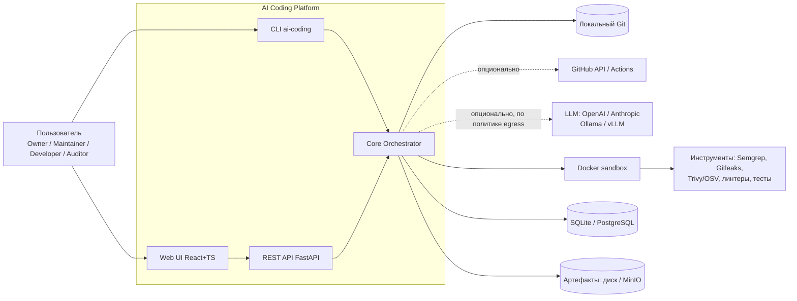
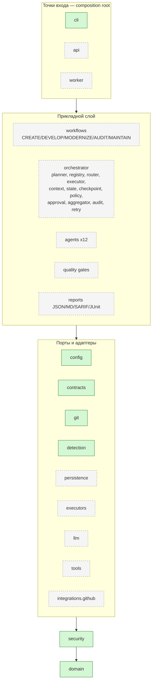
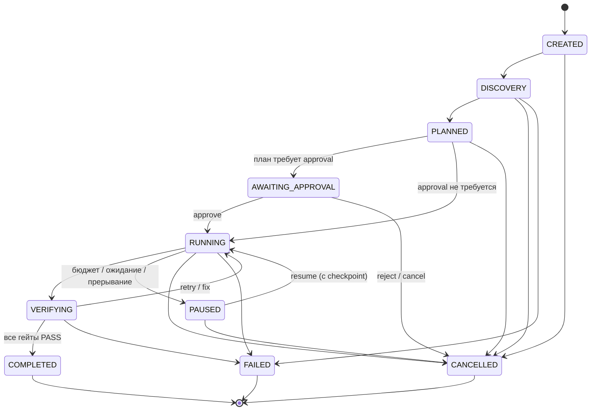
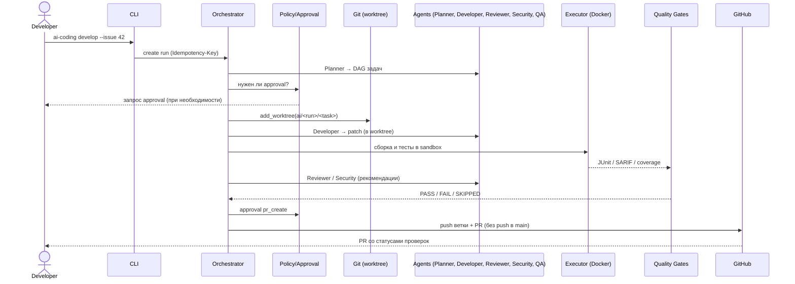
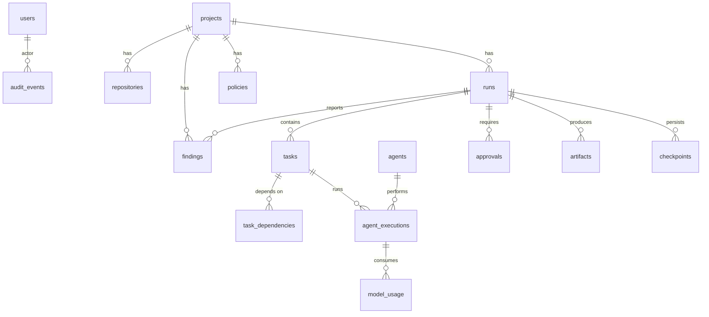

# Архитектура AI Coding Platform v2.1

Документ описывает целевую архитектуру всей платформы (S1–S9). Состояние реализации каждого модуля — в [modules.md](modules.md) и [../backlog.md](../backlog.md). Решения обоснованы в [ADR](../adr/README.md).

## 1. Контекст

GitHub и LLM — **опциональны**: детерминированный AUDIT работает локально без сети (FR-12, AC-05).

## 2. Профили развёртывания (ТЗ §15)

| Профиль | Компоненты | Хранилище | Очередь |
| --- | --- | --- | --- |
| Local Lite | CLI + in-process orchestrator + Local/Docker executor + git worktree; LLM опционально | SQLite `.ai-coding/state.db`, артефакты на диске | in-process scheduler поверх БД-очереди |
| Self-Hosted | FastAPI + worker(ы) + PostgreSQL + MinIO + Web UI + Docker executor, reverse proxy с TLS | PostgreSQL, MinIO | БД-очередь (SKIP LOCKED) или Redis |
| GitHub Hybrid | Self-Hosted или CLI + GitHub App/token + reusable workflows + Rulesets | как у базового профиля | + GitHub Actions executor |

## 3. Слои и компоненты

Зелёные — реализованы в S1, серые — запланированы. Правило зависимостей проверяется `import-linter` (ADR-0003).

## 4. Жизненный цикл run (ТЗ §4)

Точная таблица переходов — артефакт S2 (State Manager), покрывается тестами на 100% ветвей (NFR-06). Переходы идемпотентны и журналируются; после рестарта выполнение продолжается с последнего подтверждённого checkpoint без повторного применения изменений (ADR-0006).

## 5. Поток DEVELOP (FR-04, AC-03)

## 6. Сквозные аспекты

| Аспект | Механизм | ТЗ |
| --- | --- | --- |
| Безопасность | ADR-0010: недоверенный контент, least privilege, sandbox, egress-политика, redaction | §12, AC-07 |
| Секреты | Не в YAML (валидатор S1), Redactor для логов/prompts/артефактов, gitleaks | FR-18, NFR-07 |
| Аудит | append-only `audit_events` (actor, project_id, run_id, timestamp, outcome) | §3, FR-16 |
| Наблюдаемость | structlog JSON-логи с run_id/trace_id, метрики Prometheus (S8), OpenTelemetry — опционально | NFR-07 |
| Воспроизводимость | закреплённые версии инструментов и образов (digest), версии в отчётах | NFR-05 |
| Идемпотентность | Idempotency-Key в API, ключи эффектов в оркестраторе | §12, AC-04 |
| Экспорт/удаление | `report export`, удаление проекта по retention-политике | NFR-08 |

## 7. Модель данных (ТЗ §12)

Все идентификаторы — UUID, время — UTC, `runs`/`tasks` имеют `version` для optimistic concurrency (ADR-0005).
